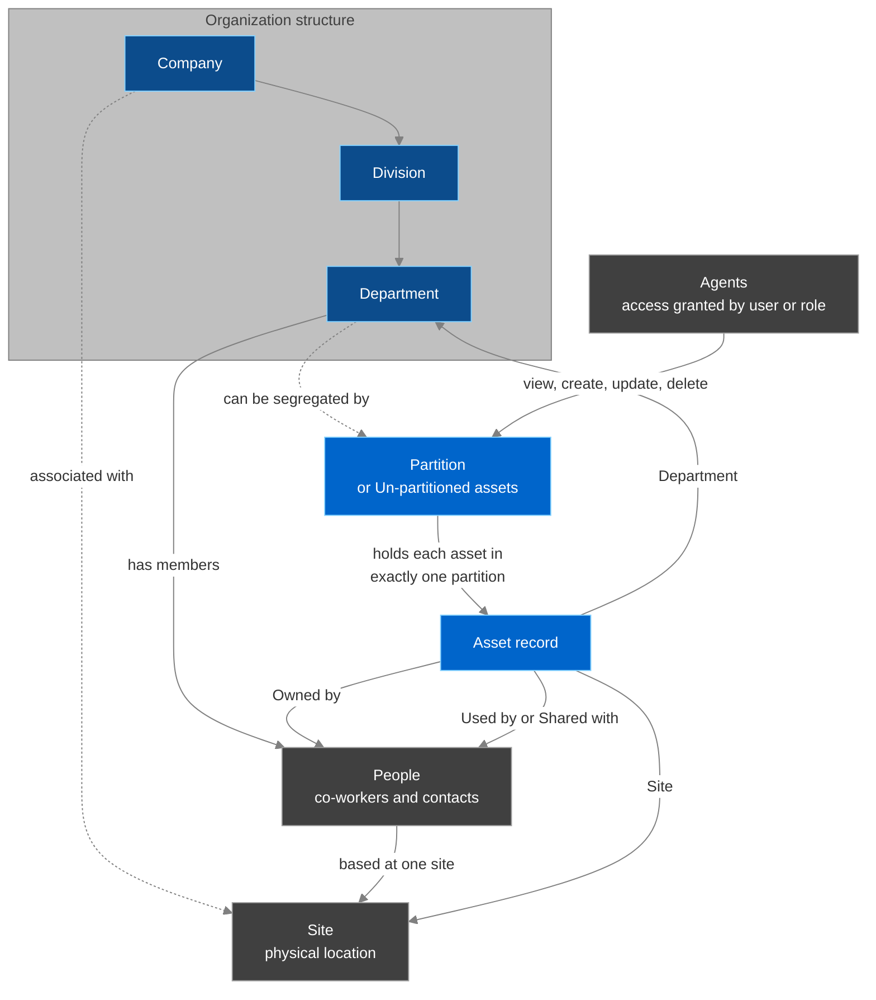

# Understanding Your Estate

## One view across multiple repositories

Where different parts of your organization need their own segregated set of assets - by business unit, region, or security requirement - Hornbill's asset partitions let you split your register into access-controlled groups, each with its own permissions, while still giving appropriately privileged users a single consolidated view across all assets and partitions.

**Learn more:** [Assets Overview](/servicemanager-config/assets/manage-partitions)

## How assets relate to partitions, sites, departments, and people

- **Partitions** control who can see and manage an asset. Every asset sits in exactly one partition, or in the Un-partitioned container, and agents are given access to a partition by user or role.
- **Sites** record where an asset physically is. Sites can be associated with a company in your organization structure, and each person is based at one site.
- **People** are linked to an asset as its owner, and as either its single primary user (*Used by*) or one of several users it is *Shared with*.
- **Departments** are groups of the *Department* type in your organization structure. An asset's *Department* field links it directly to one of these groups, and the people in the department are members of the same group. Where a department's assets need to be kept separate, you can give that department its own partition.

**Learn more:** [Asset Details](/servicemanager-user-guide/asset-management/asset-details) | [Locations](/esp-config/organizational-data/locations) | [Groups and Teams](/esp-config/organizational-data/organization)

## Defining your authorized asset portfolio

Because every asset must be created against a defined asset type, and asset types are themselves configured and controlled by administrators, your asset type list effectively defines the portfolio of authorized, supported IT assets for your organization. Assets discovered or imported that don't match an authorized type or model can be surfaced through Hornbill's reporting to help identify unauthorized or unsupported items.

**Learn more:** [Manage Asset Types](/servicemanager-config/assets/asset-types-overview)
